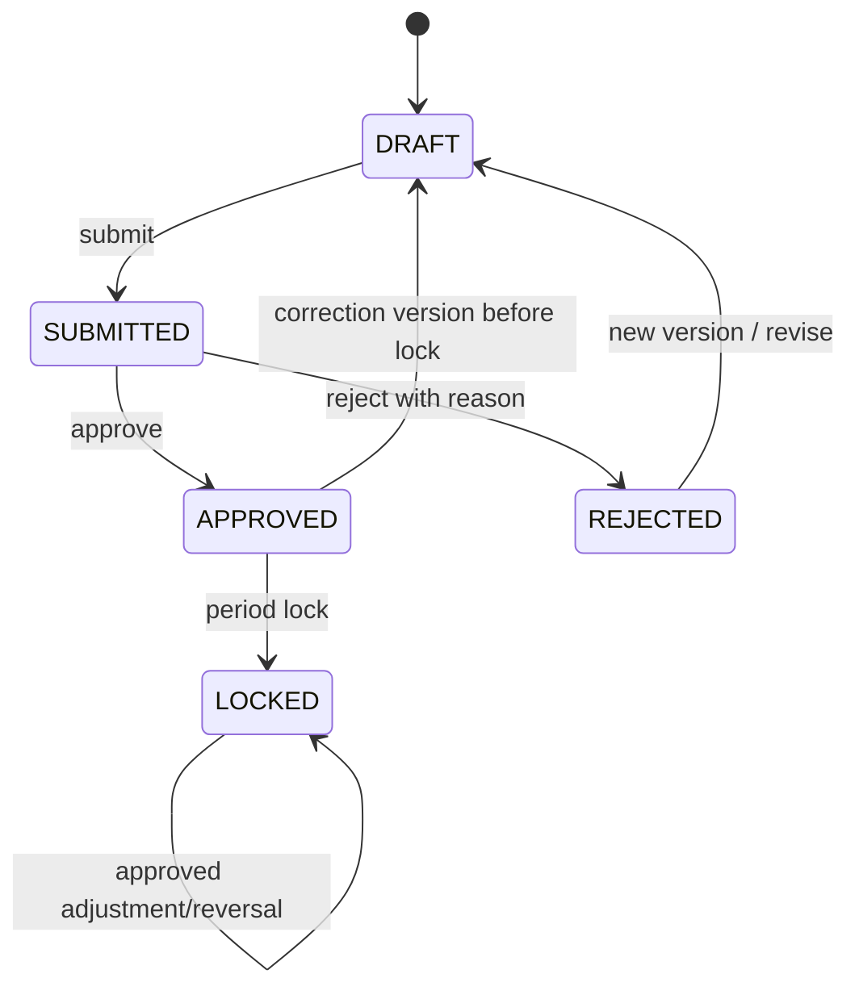

# Financial Data Lifecycle

## Version 1 workflow

Use all five statuses because they encode materially different authority without forcing later redesign:

- **DRAFT:** non-authoritative; creator/editor with unit write grant can change it.
- **SUBMITTED:** frozen for ordinary editing; awaits an authorized approver.
- **APPROVED:** authoritative and eligible for KPIs/reconciliation.
- **REJECTED:** non-authoritative; reason required; revision creates a new current version.
- **LOCKED:** authoritative period close; no ordinary updates/deletes.

If Version 1 UI must be smaller, REJECTED can be represented as DRAFT plus rejection metadata, but the database status should remain available.

## Actors

- Create/edit: `financial.create/update` plus write access to the record's unit/scope; only DRAFT/REJECTED.
- Submit: `financial.submit`, usually the preparer; transition records atomically.
- Approve/reject: `financial.approve` plus access to scope; recommended different user from submitter.
- Lock: `financial.lock`, faculty-level access, and all required validation/reconciliation checks complete or formally waived.
- Import confirmation: `import.approve`; creates SUBMITTED or APPROVED records according to separation-of-duties policy. Recommended Version 1 creates SUBMITTED records.

## Authority and locking

Data becomes authoritative only at APPROVED. Dashboards/KPIs exclude DRAFT, SUBMITTED, REJECTED and soft-deleted versions. Locking applies to a reporting period and changes APPROVED entries to LOCKED or treats period lock as an equivalent query rule.

After lock:

- ordinary edits and soft deletes are denied;
- authorized corrections use an immutable ADJUSTMENT or REVERSAL entry with reason and approval;
- reopening a period requires a special capability, reason, dual approval if feasible, and audit events;
- the original amount remains queryable and unchanged.

## Deletion

Hard delete is prohibited for financial and audit records after submission. Draft mistakes may be soft-deleted with actor/time/reason. Imports may delete unconfirmed staging rows. Confirmed imports are rolled back by transaction failure before commit or by controlled reversals/voiding after commit—not by deleting ledger history.

