# Database Schema Design

The implemented PostgreSQL schema is defined by ordered files in [`database/migrations`](../database/migrations). The original [`database/schema.sql`](../database/schema.sql) is retained as the Phase 2 design draft, not as the Phase 4A migration entry point. No real financial data is included in migrations or seeds.

## Phase 4A implementation update

Phase 4A adds explicit reporting years and parent/child periods, FLOW/SNAPSHOT/DERIVED metric behavior, SUM/LATEST/DERIVED/NONE aggregation, ANNUAL/PERIOD/UNKNOWN budget scope, completeness/year-state types, append-only adjustment/reversal enforcement, deterministic aggregation views/functions, reconciliation calculation, audit immutability and RLS foundations.

## Modeling decisions

- A unified `financial_records` ledger is preferable to separate `budget_records`, `liquidity_records` and `government_budget_records`. Stable `financial_metrics` and `financial_categories` express actual revenue, budgeted expense, assets, liabilities, government budget, etc. This avoids duplicated workflow, audit and authorization logic.
- Monetary amounts use `NUMERIC(20,2)`. KPI ratios/tolerances use bounded `NUMERIC`, never floating point.
- Faculty and unit scope are explicit. `FACULTY` requires `unit_id IS NULL`; `UNIT` requires a unit.
- Base values, adjustments and reversals are distinct entries. `record_group_id/version_no/is_current` version a logical entry; approved history is not overwritten.
- A partial unique index prevents two current BASE records at the same period/scope/unit/metric/category grain. Legitimate adjustments remain possible through unique adjustment references.
- `reporting_periods` stores a period type, optional parent period, source labels, optional month, optional dates, display order and active/locked state. Dates remain nullable until approved; fiscal year, quarter and month records may form a configurable hierarchy.
- Import, reconciliation, KPI configuration and audit are first-class tables.

## Evaluation of requested candidate tables

| Candidate | Decision |
|---|---|
| profiles, roles, permissions, role_permissions, user_roles | Keep; capabilities are many-to-many and user roles may expire. |
| organizational_units, user_unit_access | Keep; add unit aliases for exact Excel lineage. |
| reporting_periods | Keep; configurable calendar is mandatory. |
| financial_categories | Keep; hierarchical bilingual categories such as government budget categories. |
| financial_records | Keep as the unified versioned ledger. |
| budget_records | Do not separate; budget is a financial metric. |
| liquidity_records | Do not separate; current assets and liabilities are source metrics; liquidity is derived. |
| government_budget_records | Do not separate; use metrics plus categories to share workflow and controls. |
| kpi_definitions, kpi_thresholds | Keep and version definitions. |
| import_batches, import_staging_records, import_errors | Keep; name errors `import_issues` to support warnings and errors. |
| reconciliations | Keep; add configurable `reconciliation_rules`. |
| audit_logs, system_settings | Keep; forbid secrets in settings. |

## Entity relationships

```mermaid
erDiagram
  PROFILES ||--o{ USER_ROLES : has
  ROLES ||--o{ USER_ROLES : assigned
  ROLES ||--o{ ROLE_PERMISSIONS : grants
  PERMISSIONS ||--o{ ROLE_PERMISSIONS : included
  PROFILES ||--o{ USER_UNIT_ACCESS : receives
  ORGANIZATIONAL_UNITS ||--o{ USER_UNIT_ACCESS : limits
  ORGANIZATIONAL_UNITS ||--o{ ORGANIZATIONAL_UNIT_ALIASES : has
  ORGANIZATIONAL_UNITS ||--o{ ORGANIZATIONAL_UNITS : parent_of

  REPORTING_PERIODS ||--o{ FINANCIAL_RECORDS : contains
  ORGANIZATIONAL_UNITS ||--o{ FINANCIAL_RECORDS : owns
  FINANCIAL_METRICS ||--o{ FINANCIAL_RECORDS : measures
  FINANCIAL_CATEGORIES ||--o{ FINANCIAL_RECORDS : categorizes
  FINANCIAL_RECORDS ||--o{ FINANCIAL_RECORDS : adjusts
  PROFILES ||--o{ FINANCIAL_RECORDS : creates_approves

  IMPORT_BATCHES ||--o{ IMPORT_STAGING_RECORDS : stages
  IMPORT_BATCHES ||--o{ IMPORT_ISSUES : reports
  IMPORT_STAGING_RECORDS ||--o{ IMPORT_ISSUES : has
  IMPORT_BATCHES ||--o{ IMPORT_COMMITS : commits
  IMPORT_STAGING_RECORDS ||--o{ IMPORT_COMMITS : maps
  FINANCIAL_RECORDS ||--o{ IMPORT_COMMITS : created_as

  FINANCIAL_METRICS ||--o{ RECONCILIATION_RULES : configures
  REPORTING_PERIODS ||--o{ RECONCILIATIONS : reconciles
  FINANCIAL_METRICS ||--o{ RECONCILIATIONS : compares
  KPI_DEFINITIONS ||--o{ KPI_THRESHOLDS : classifies
  PROFILES ||--o{ AUDIT_LOGS : acts
```

## Authoritative record query

An authoritative fact is a current, non-deleted `APPROVED` or `LOCKED` entry. The service aggregates BASE + approved ADJUSTMENT + approved REVERSAL for one explicit scope. It must never combine `FACULTY` and `UNIT` scopes. A later database view may encapsulate this rule once workflow semantics are finalized.

## Duplicate and adjustment behavior

- Staging computes a duplicate fingerprint before commit and checks both the batch and current BASE grain.
- Identical re-upload is warning/error according to approved import policy; the file hash prevents accidental duplicate uploads by the same user.
- Correcting an unapproved draft may create a new version and retire the current version.
- Correcting approved/locked data requires an adjustment or reversal with reason, reference and separate approval; no physical overwrite.
- Period lock blocks ordinary changes. Reopening or post-lock adjustment is an explicit capability and audit event.

## Integrity not encoded prematurely

No database constraint maps Q1–Q4 to months, forces Faculty = SUM(Unit), assigns unapproved tolerance, or treats zero denominator as zero. These are governed application/KPI rules awaiting Faculty decisions.
