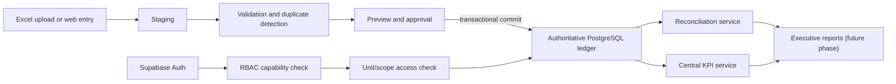

# Phase 2 — System Architecture

## Architecture outcome

Use a **modular monolith** built with Next.js, TypeScript and Tailwind CSS; Recharts for later presentation; PostgreSQL as the authoritative database; and Supabase Auth/PostgreSQL for the prototype. Domain modules share one deployable application and database but enforce boundaries through server-side services and database schemas/policies.

## Module boundaries

| Module | Responsibility | Must not do |
|---|---|---|
| Identity & Access | Session, profiles, roles, capabilities, unit grants, RLS context | Calculate KPIs |
| Calendar & Master Data | Configurable reporting periods, units, aliases, categories, metrics | Infer quarter/month mapping |
| Financial Ledger | Versioned source values and adjustments by period/scope/unit/metric | Force faculty totals to equal unit sums |
| Workflow | Draft, submit, approve/reject, lock | Grant authority through UI visibility |
| Import | Upload, parse, stage, validate, preview, confirm/rollback | Write uploads directly to authoritative records |
| Reconciliation | Faculty total vs unit sum snapshots, tolerance, review/resolution | Alter source amounts |
| KPI | Versioned definitions and deterministic server-side calculation | Put formulas in React components |
| Audit | Immutable event trail and security/financial change context | Store secrets or serve as operational state |
| i18n | Locale routing, application messages, bilingual master-data selection | Duplicate numerical facts by language |

## Request boundaries

- Browser uses the public Supabase client only for authentication/session and explicitly permitted RLS-protected reads.
- Mutating financial, approval, import and administrative operations go through Next.js Server Actions/route handlers.
- Server handlers validate input, require capabilities, require unit/scope access, enforce workflow state, invoke a transaction, and write audit events.
- RLS remains defense in depth and protects against accidental direct data access. Service-role credentials are server-only and should be avoided for ordinary user operations; if used for a privileged transaction, the server must re-authorize and pass actor context.

## Portability

Keep Supabase-specific code behind `lib/auth/provider` and `lib/database/client`. PostgreSQL schema, capabilities, unit grants, business records, KPI definitions and audits are provider-neutral. The draft SQL has a single `app.current_profile_id()` adapter using `auth.uid()`; migration to university identity replaces that function/provider adapter rather than domain tables.

Use object storage through an interface. Store only storage keys and hashes in PostgreSQL, allowing Supabase Storage to be replaced with university object storage. Avoid Supabase-only Edge Functions for core domain logic.

## Authoritative reporting rules

- Faculty executive KPIs query approved/locked `FACULTY` records where available.
- Unit performance queries approved/locked `UNIT` records authorized for the viewer.
- Reporting periods preserve imported labels and have configurable dates/order; no quarter-to-month assumption is compiled into code.
- สภาพคล่องทางการเงิน / Financial Liquidity remains Current Assets ÷ Liabilities and is versioned/documented as a KPI definition, never renamed Current Ratio.
- Growth KPIs are calculated from authoritative period records; historical facts are not rewritten to store growth.

## Non-goals for Phase 2

No dashboard UI, complete data-entry/admin pages, production connection, external upload, deployment or confidential-data migration was performed.

